

<!-- _class: lead -->
<!-- _paginate: false -->

## Programming in the Era of AI

**Daniel Lemire**, professor
Université du Québec (TÉLUQ)
Montréal :canada:

blog: https://lemire.me

X: [@lemire](https://x.com/lemire) · GitHub: [github.com/lemire](https://github.com/lemire/)

---

---

# Where I am coming from

- Author of high-performance libraries integrated into major browsers, runtimes and standard libraries: **simdutf**, **fast_float**, **simdjson**, **Roaring Bitmaps**.
- Among the top 2% of scientists worldwide (Stanford/Elsevier), 100+ peer-reviewed papers.
- Among the 1000 most-followed developers on GitHub.
- **And: I have not typed most of my code by hand in over a year.**

---

<!-- _class: lead -->

## Preface

## Back in the 1990s

---

# The singularity

> « I believe that the creation of greater than human intelligence will occur during the next thirty years. (I'll be surprised if this event occurs before 2005 or after 2030.)  »

Vernor Vinge, 1993

---

<!-- _class: lead -->

## Part 1

## Where we actually are

---

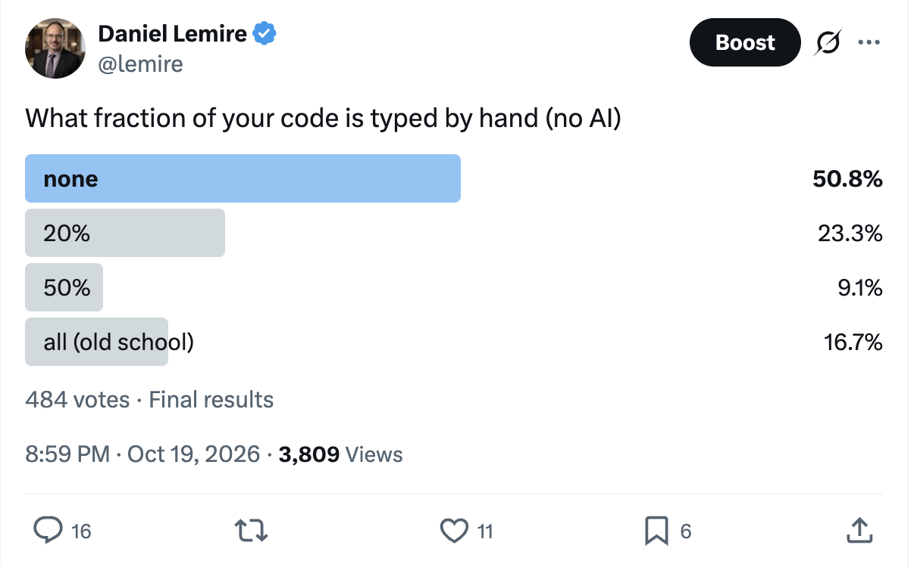

---

# SWE-bench Verified

- Real GitHub issues from real open-source Python repositories.
- The model gets the repository, the issue text, and nothing else.
- Success = the project's own **hidden tests** pass afterwards.
- 500 tasks, human-validated as solvable.

---

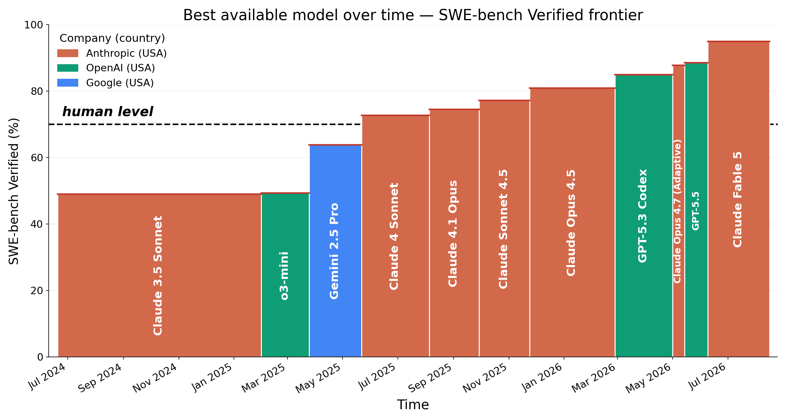

---

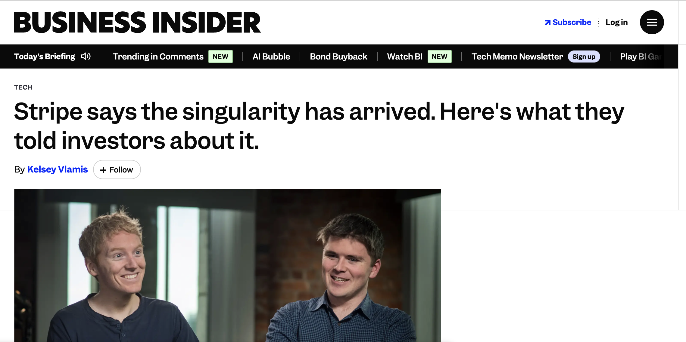

> January 1st marked the beginning of the singularity.

—Stripe, August 19, 2026

---

> People often talk about this concept called AGI, meaning artificial general intelligence, that is, an AI as intelligent as a person. I actually think we crossed that threshold about three months ago.

— Marc Andreessen, May 19, 2026

---

# A summer of AI optimization

- Six mature open-source libraries: roaring, CRoaring, ada, fast_float, simdjson, simdutf.
- Shipped in GCC, Chromium, Node.js... used by millions.
 d
---

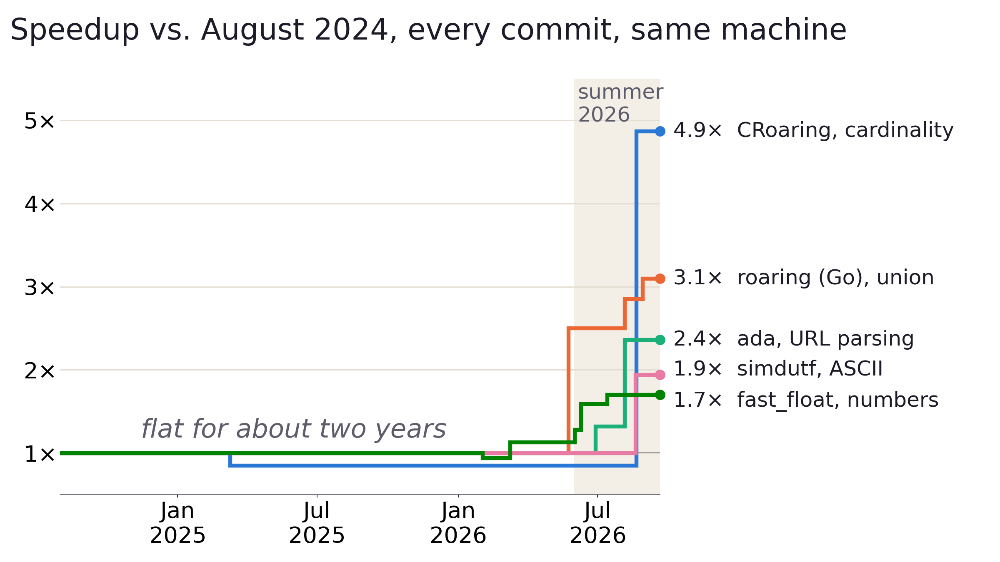

---   c

---

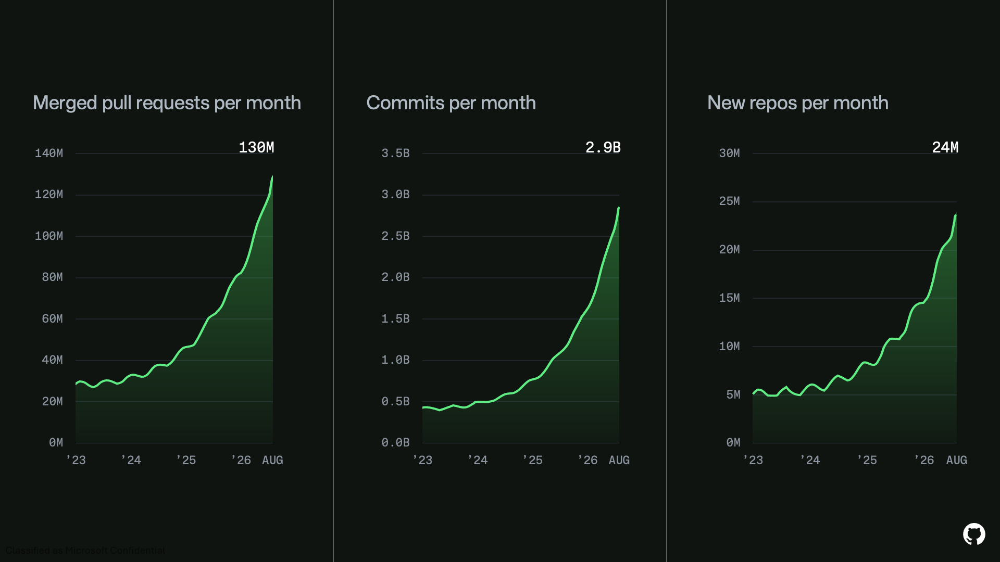

---

# Jevons paradox

- 1865: William Stanley Jevons, *The Coal Question*.
- James Watt's steam engines burned far less coal per unit of work...
- ...and Britain's coal consumption **went up**, not down.

**When something gets cheaper to use, we use much more of it.**

- Tokens got cheaper: we consume far more tokens.
- Code got cheaper: we write far more code, and review, test, host and maintain it.

---

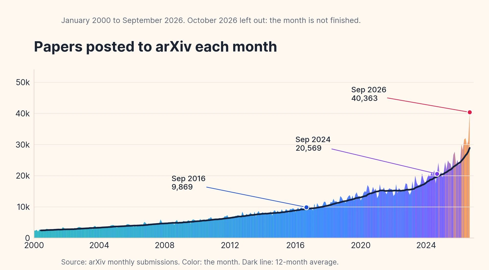

---

# arXiv capped submissions at two a month

- October 1, 2026: **two submissions per person per month.**
- September 2026: over 40,000 papers, up from about 20,000 two years earlier.
- Doubling every two years. Moderated by volunteers.
- Google stopped accepting new bug reports in its open-source bounty program: they could not cope with the influx.

**Producing got cheap. Human attention did not.**

<small>lemire.me/blog/2026/10/04/arxiv-capped-submissions-at-two-a-month/</small>

---

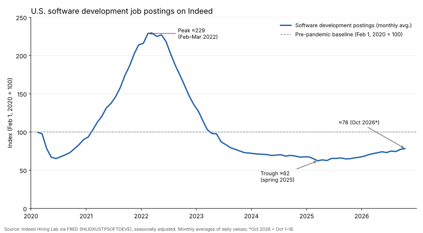

---

<!-- _class: lead -->

## Memory

---

<!-- _class: diagram -->

# How an LLM works

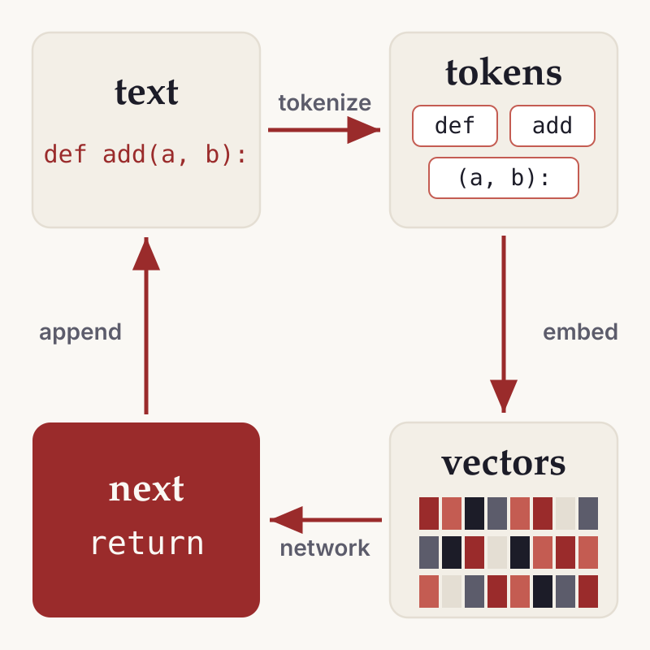

---

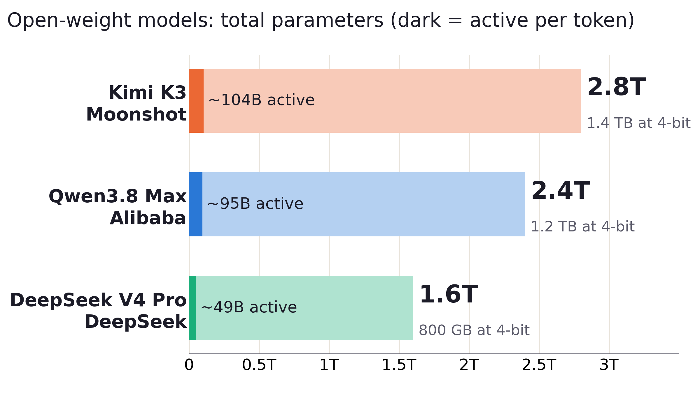

---

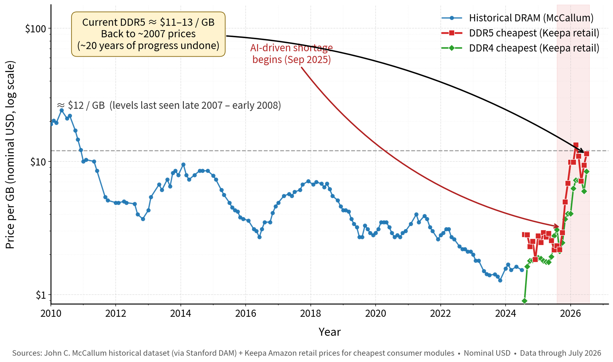

---

# How can a language model write software?

* I write a query, it is maybe 80 characters.
* I get back a full program with 100,000 lines.
* Not how it works, there is more information invovled.

---

<!-- _class: diagram -->

# The inference loop

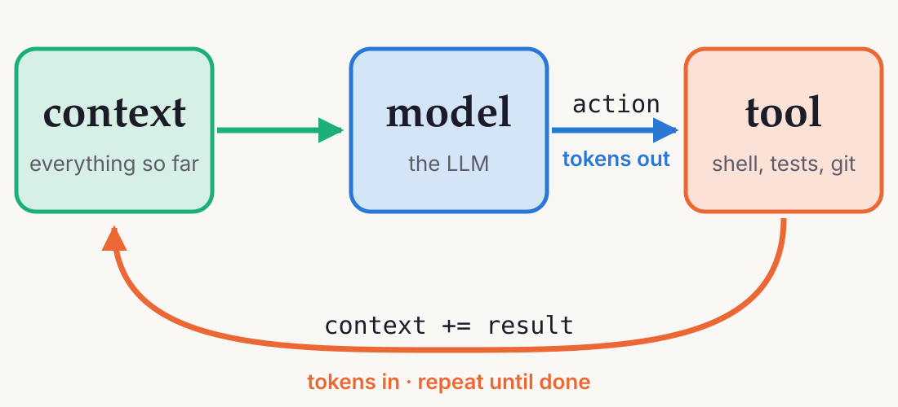

---

<!-- _class: diagram -->

# Reinforcement learning

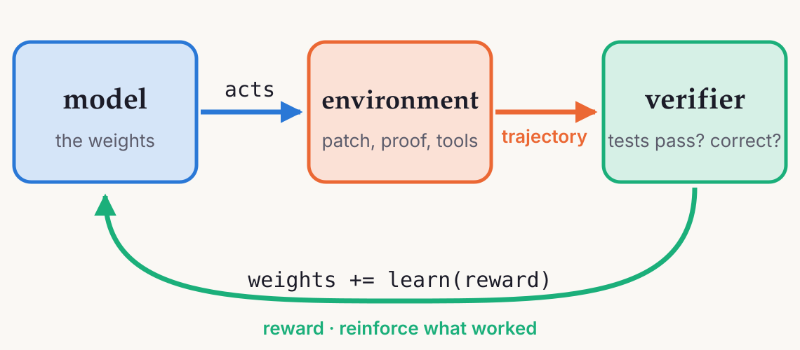

---

<!-- _class: lead -->

## Challenges

---

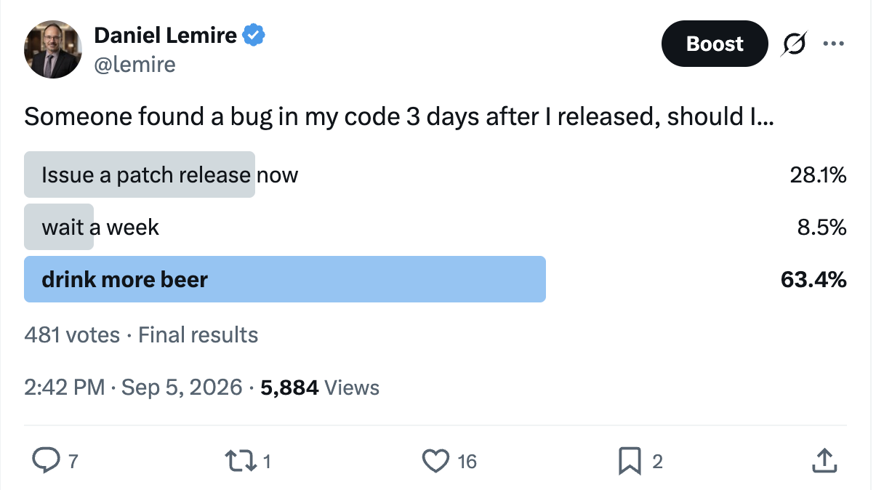

---

# Teaching 

- How to teach software development in the AI era. @fromdevoid
- “Is it still worth learning to program?” @birkenkrahe
- Are security risks a difference in degree or in kind? @gcomeaudotcom
- How to think, how to set goals, and how to express yourself clearly. @JoyfulBadger

---

# Quality

- Include the tests! @nabendu82
- Can you verify the code? @MatRopert
- How good are the tests? @dyaroshev
- How to have rigor? @opdroid1234
- Someone still needs to explain/understand? @jrdi

---

<!-- _class: lead -->

## Emerging ideas

---

# Emerging idea: ephemeral testing

1. Build a component (by hand or with an agent).
2. Ask an agent to build **throwaway software on top of it**: an app, another layer.
3. Have it test what it built.
4. Judge the foundation by how well the layers above work. Then discard them.

<small>lemire.me/blog/2026/10/05/ephemeral-testing/</small>

---

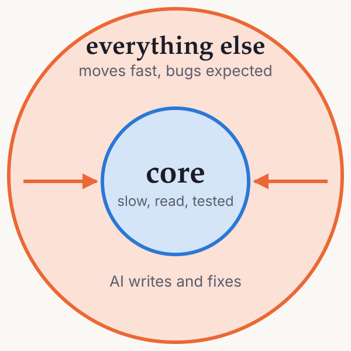

# Emerging idea: a layered model

- Keep a **small core** that changes slowly and on purpose.
- For the core, you read the code. You insist on tests. No vibe coding.
- **Everything else can move fast.** There will be bugs, but the AI fixes them quickly.
- **The core cannot depend on the outer layers.**

<small>lemire.me/blog/2026/09/05/ai-programming-a-layered-model/</small>

---

# Emerging idea: cheap custom software

1. Build your own video software https://github.com/lemire/lemirecut
2. Your own election-night app https://lemire.me/montmorency2026/

---

# Emerging idea: AI-first operating software

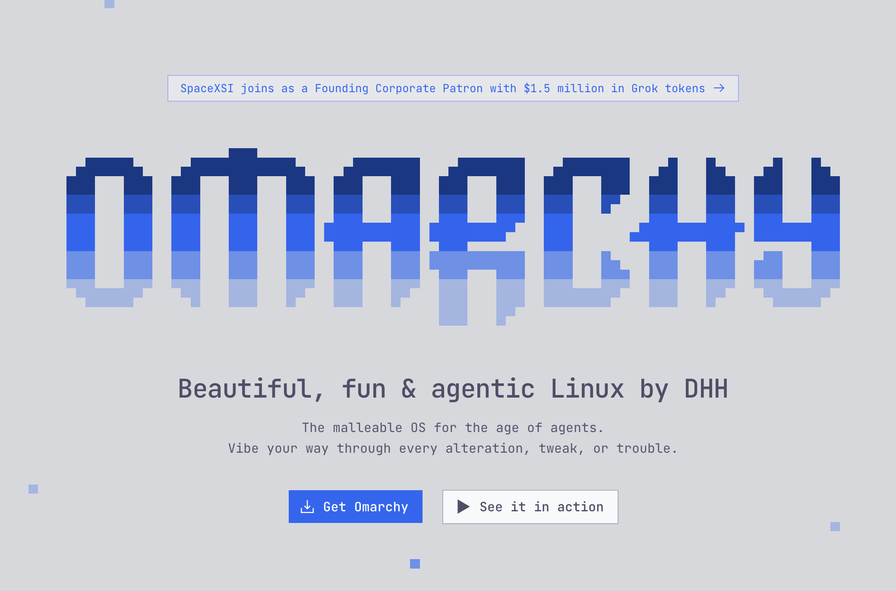

---

<!-- _class: lead -->
<!-- _paginate: false -->

## Questions?

**Daniel Lemire** — [lemire.me](https://lemire.me) (blog)

<https://simdjson.org> · <https://roaringbitmap.org>

<https://simdutf.github.io/simdutf/> · <https://fastfloat.github.io/fast_float/>

:canada:

# TODO

- fast paced bug catching https://x.com/lemire/status/2096307923861336399?s=20
- add https://lemire.me/blog/2026/09/05/ai-programming-a-layered-model/
- verfiable vs non-verifiable, Cette notion de ce qui est vérifiable et de ce qui est difficilement vérifiable.
- more performant software (bar higher), more correct software 
- historical reviewers
- explicit knowledge, genie in the bottle
- AI and credentialism, reputation system
- system understanding, animation, videos
- spam filters
- Formal verification
- https://x.com/thorstenball/status/2101305394190557466?s=46&t=-zo9kVFDyKuN4X1cdtkIrw
- jagged skills

---

**Report on ideas from replies to your post** ([https://x.com/lemire/status/2109392496950218957](https://x.com/lemire/status/2109392496950218957)) **plus Ronan Tournier’s comment** ([https://x.com/RonanTournier/status/2110054920661488002](https://x.com/RonanTournier/status/2110054920661488002)).

Your post asked for talk ideas on AI and programming for a young audience. You later posted a thank-you noting you would try to give credit. Below is a concise synthesis of the substantive suggestions that appeared, grouped by theme, with author credit.

### State of tools, cognitive dissonance, and data scarcity
- **Hassan Abedi (@Hassan_Abedi)**: Current state of AI-assisted coding tools and where they are heading in the near future; or the cognitive dissonance of people who use these tools daily for software engineering yet say they hate “AI slop.”
- **Ninad Sachania (@NinadSachania)**: Gell-Mann Amnesia (the tendency to trust reporting/expertise in domains you do not know while recognizing its flaws in domains you do know—relevant to how people assess AI-generated code).
- **aa1337**: Demonstrate AI reading all your blog posts and using that knowledge to obtain large speedups on a widely used piece of code.
- **Ronan Tournier (@RonanTournier)** (reply to your thank-you post): The need for ever more coding examples to feed the models. He is impressed by current results but notes the scarcity for advanced SQL—there simply are not enough high-quality advanced examples online (SQL standing in for any domain whose sophisticated code is under-represented on the public internet). (He also corrected a typo: “feed” not “feet.”)

### Practical takeaways for the talk
The recurring threads are:
1. Verification and judgment remain the bottleneck (testing quality, explaining why something is wrong/slow, responsibility).
2. Teaching and curricula have not caught up; students need both fundamentals and new agentic practices, plus domain knowledge outside pure coding.
3. Data limitations still matter in less-represented areas (advanced SQL and similar domains).
4. Soft skills (clear thinking, goal-setting, expression) and rigorous use of AI tools are useful entry points for a young audience.

These points come directly from the listed authors. If you want quotes expanded, a particular angle prioritized, or help turning any of them into slide outlines, say which ones.

---

"/Users/dlemire/Desktop/ipo.png"
