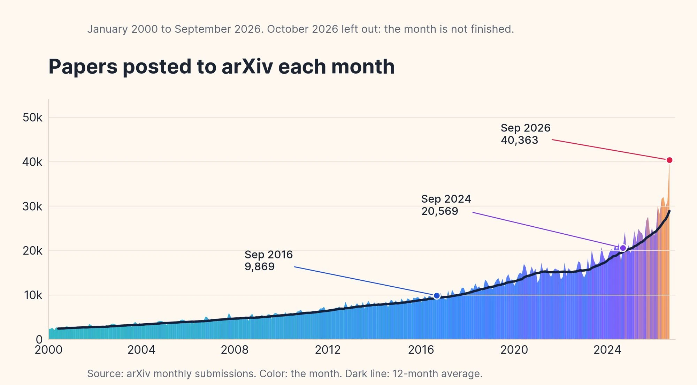
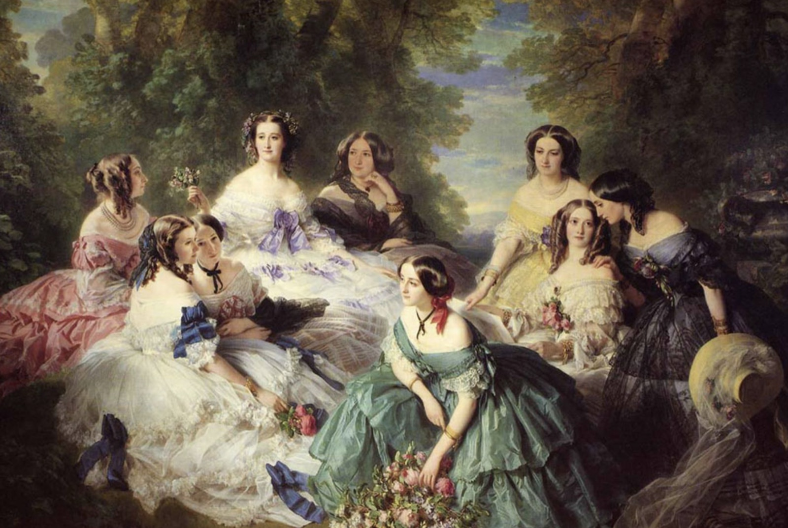
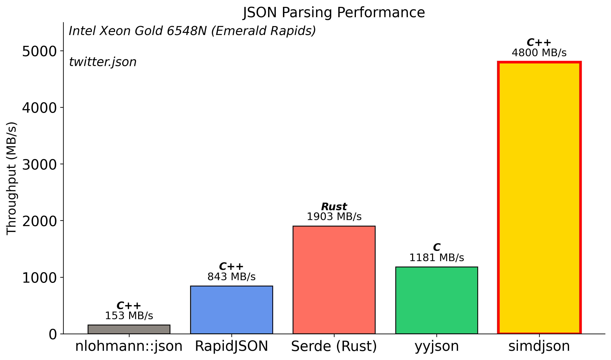
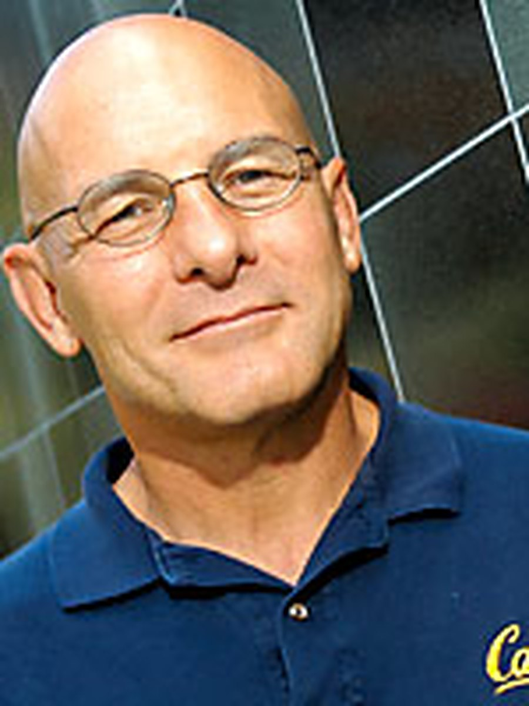

<!-- _class: lead -->
<!-- _paginate: false -->

## Open Source as a Research Method

### *From the research paper to billions of devices*

**Daniel Lemire**, professor
Université du Québec (TÉLUQ)

blog: https://lemire.me

X: [@lemire](https://x.com/lemire) · GitHub: [github.com/lemire](https://github.com/lemire/)

---

<!-- _class: quote with-photo -->

<blockquote>

The problem in this business isn't to keep people from stealing your ideas; it's making them steal your ideas.

</blockquote>

<strong>Howard Aiken</strong> quoted by David Patterson, 2017 Turing Award

<figure class="portrait wide">

</figure>

---

<!-- _footer: "" -->

---

# The linear model of innovation

- The professor thinks. The professor publishes.
- The engineer reads, designs.
- The customer consumes.

---

<!-- _class: quote with-photo -->

<blockquote>

The industrial revolution was driven by demand for cheap and better clothing for the masses.

</blockquote>

<figure class="portrait">

<figcaption>David Monniaux, CC BY-SA 4.0</figcaption>
</figure>

---

<!-- _class: quote with-photo -->

<blockquote>

In effect, our customer has vanished and been replaced by either the whales or a vacuum. This loss of our customer has resulted in a collection of bad effects. First, there are no “real world” clients to keep us focused.

</blockquote>

<strong>Michael Stonebraker</strong> — “Where We Have Failed” <em>Making Databases Work</em>, 2018

<figure class="portrait">

<figcaption>David Monniaux, CC BY-SA 4.0</figcaption>
</figure>

---

<!-- _class: lead -->

## A story: *simdjson*

---

<!-- _class: step -->

# Step 1 — parsing JSON

2019

- JSON is everywhere, and parsing it is **slow**

<pre><code>{
  "Image": {
    "Width": 800,
    "Height": 600,
    "Title": "View from 15th Floor",
    "Thumbnail": {
      "Url": "http://www.example.com/81989943",
      "Height": 125,
      "Width": 100
    }
  }
}</code></pre>

---

<!-- _class: quote with-photo -->

<blockquote>

The scientist builds in order to study; the engineer studies in order to build.

</blockquote>

<strong>Frederick P. Brooks, Jr.</strong> “The Computer Scientist as Toolsmith II,” CACM, 1996

<figure class="portrait">

<figcaption>David Monniaux, CC BY-SA 3.0</figcaption>
</figure>

---

<!-- _class: chart -->
<!-- _footer: "" -->

---

<!-- _class: quote -->

# The real publication

> An article about computational science in a scientific publication is not the scholarship itself, it is merely advertising of the scholarship. The actual scholarship is the complete software development environment and the complete set of instructions which generated the figures.

<strong>Jon Claerbout</strong> — as recorded by Buckheit and Donoho, 1995

---

# Step 2 — bottleneck: numbers

Revealed by use

- Once everything else is fast, parsing **floating-point numbers** becomes the bottleneck.
- Result: the **Eisel-Lemire** algorithm, exact and fast (*Number Parsing at a Gigabyte per Second*).
- Adoption: Rust, Go, .NET, C++ — the standard libraries themselves.
---

<!-- _class: quote -->

# Where do ideas come from?

> I never come up with anything by going off to a mountaintop to think. Instead, my ideas come from two sources: talking to real users with real problems and then trying to solve them. This ensures I come up with ideas that somebody cares about and the rubber meets the road and not the sky.

<strong>Michael Stonebraker</strong> — 2014 Turing Award · Ingres, PostgreSQL, Vertica

---

# Step 3 — another bottleneck: UTF-8

Revealed by use

- Parsing JSON also means **validating** UTF-8: security depends on it.
- Goal reached: validation in **less than one instruction per byte**.
- That piece broke off to become a library of its own: **simdutf**.
- Adoption: Node.js, Bun, Deno, browsers — Unicode validation and transcoding for the web.

---

<!-- _class: quote with-photo -->

<blockquote>

For my successful projects, the early indicators were not papers or awards, but non-researchers trying to use our ideas.

</blockquote>

<strong>David Patterson</strong> “How to Build a Bad Research Center,” CACM, 2014

<figure class="portrait">

<figcaption>Peg Skorpinski, CC BY-SA 3.0</figcaption>
</figure>

---

<!-- _class: lead -->

## Thank you

**Daniel Lemire** · Université du Québec (TÉLUQ)

blog: https://lemire.me

X: [@lemire](https://x.com/lemire) · GitHub: [github.com/lemire](https://github.com/lemire/)

*simdjson · fast_float · simdutf · Roaring Bitmaps*
